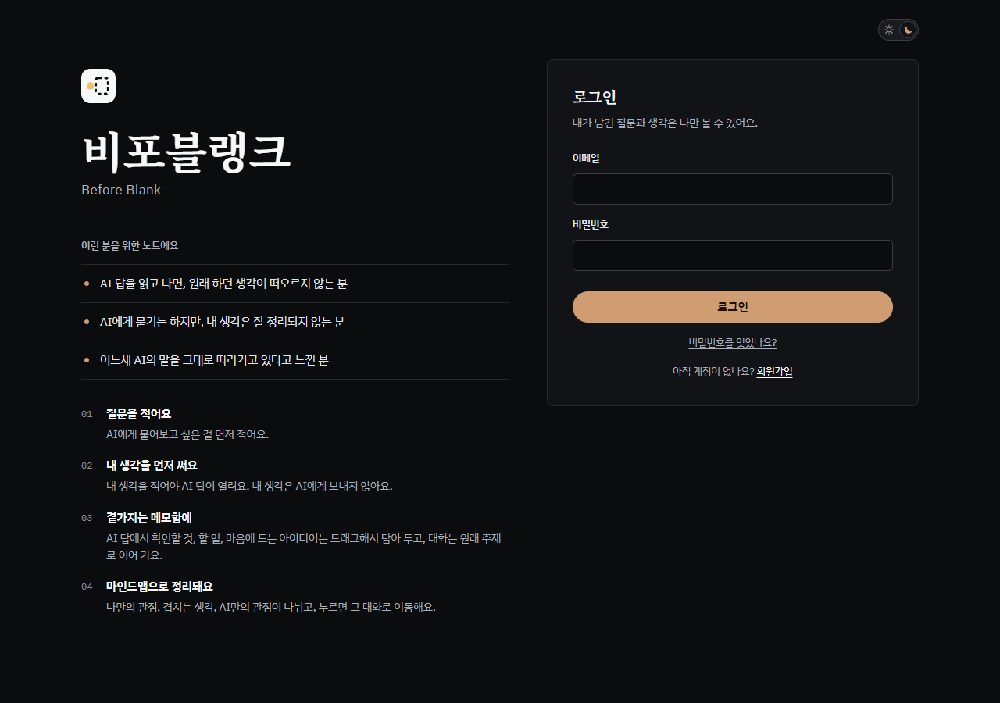
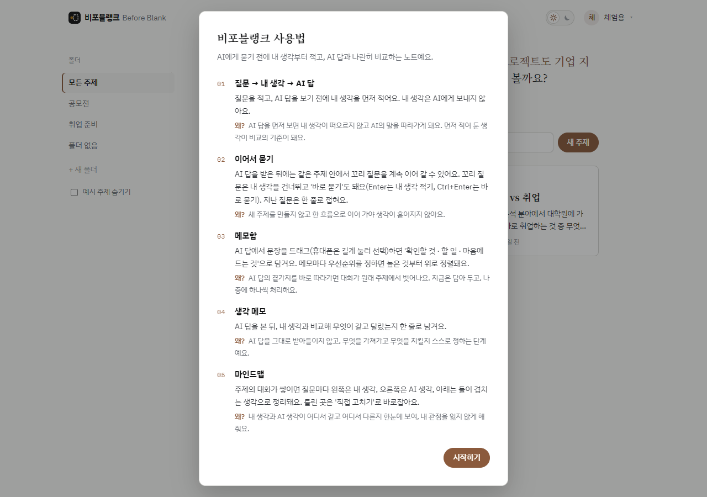
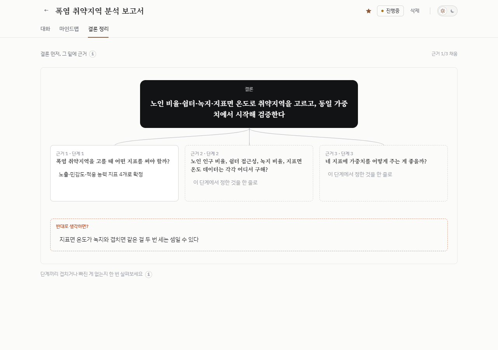

# 비포블랭크 Before Blank

> 줄여서 **비비**. AI에 끌려가지 않고, **AI를 주도적으로 쓰도록** 돕는 질문 노트



## 왜 만들었나 — 세 가지 취지

AI는 잘 쓰면 생각을 넓혀 주지만, 끌려가면 생각을 대신해 버립니다. 비포블랭크는 AI를 주도적으로 쓰는 습관을 만드는 세 가지 장치를 담았습니다.

1. **대화는 원래 주제로, 곁가지는 메모함에.**
   AI는 묻지 않은 것까지 이것저것 알려 줍니다. 그걸 하나씩 따라가다 보면 원래 하려던 일에서 멀어집니다.
   비포블랭크에서는 AI 답에서 지금 다루지 않을 곁가지를 **드래그해서 메모함에 담고**(확인할 것 · 할 일 · 마음에 드는 것), 우선순위를 붙여 둔 채 대화는 원래 방향으로 이어 갑니다.
2. **주제마다 대화를 마인드맵으로 자동 정리.**
   대화가 길어져도 주제별 마인드맵에서 핵심을 한눈에 보고, 요점을 누르면 그 내용을 나눈 대화 위치로 바로 이동합니다.
3. **AI 결과물보다 내 아이디어를 먼저.**
   AI가 모든 걸 정해 주고 결과물을 내주면, 내가 생각했던 것과 달라도 AI 결과를 따라가고 내 아이디어는 잊게 됩니다.
   그래서 **AI 답을 보기 전에 내 생각을 먼저 적어야** 하고(글자 수 제한은 없음), AI에게는 내 생각을 보내지 않아 맞장구 없이 비교할 수 있으며, 마인드맵이 **나만의 관점 / 겹치는 생각 / AI만의 관점**을 나눠 보여 줍니다.

## 누구를 위한 앱인가

- AI 답을 읽고 나면, 원래 하던 생각이 떠오르지 않는 분
- AI에게 묻기는 하지만, 내 생각은 잘 정리되지 않는 분
- 어느새 AI의 말을 그대로 따라가고 있다고 느낀 분

## 예시로 보는 쓸모

`python seed_demo.py`로 넣는 예시 데이터에 세 가지 취지가 그대로 담긴 사례가 있습니다.

- **폭염 취약지역 분석 보고서** — '오늘 지표를 확정한다'는 목표로 시작합니다. AI가 3D 지도, 웹 공유, 위성 보정, 엔트로피 가중치 같은 곁가지를 꺼낼 때마다 따라가지 않고 메모함에 담아 둡니다(확인할 것 4 · 할 일 3 · 마음에 드는 것 2, 우선순위 표시). 그래서 대화 세 번, **41분 만에** 지표·출처·가중치를 확정하고, 다음 할 일은 메모함의 '높음'부터 봅니다.
- **자기소개서 첫 문단** — AI는 '~하는 분석가입니다'처럼 무난한 첫 문장을 추천했지만, 먼저 적어 둔 내 생각(경험 한 장면으로 시작)을 지키고 AI의 좋은 조언(직무 키워드, 숫자)만 골라 더합니다. 'STAR 기법', '인재상 확인'은 메모함으로.

## 화면

### 1. 대화 — 질문 · 내 생각 · AI 답이 한 세트


- 일반 채팅처럼 대화가 이어지지만, 입력창이 `① 질문 → ② 내 생각 → ③ AI 답` 단계로 되어 있고, 지금 몇 단계인지와 AI 답이 왜 아직 열리지 않는지를 바로 보여 줍니다.
- 새 주제는 이름만 정하면 바로 대화 화면으로 넘어가고, 첫 화면에서 진행 순서를 안내합니다.
- 내 생각은 AI 답을 보기 전에 적은 그대로 남고, 나중에 고칠 수 없습니다.
- 턴마다 **생각 메모**로 AI 답과 비교한 소감을 남깁니다.
- **단계로 나눠 묻기**: 한 주제는 단계 박스로 나뉩니다(예: ① 지표 고르기 → ② 수치·적정값 정하기). 꼬리 질문은 그 단계 박스 안에서만 이어 가고, 위의 단계 목차로 바로 이동합니다. 지난 단계와 단계 안의 지난 질문은 한 줄로 접힙니다.
  - 단계의 첫 질문은 내 생각을 꼭 먼저 적고, 같은 단계에서 AI 답을 받은 뒤의 꼬리 질문은 '바로 묻기'(Ctrl+Enter)로 건너뛸 수 있습니다.
  - 단계가 끝나면 **'이 단계 결론'**을 한 줄로 적습니다. AI에게는 **지금 단계의 대화 + 앞 단계에서 내가 적은 결론만** 보내서, 단계끼리 섞이지 않고 깊이 파고들어도 산으로 가지 않습니다. 무엇을 다음 단계로 넘길지 사람이 정합니다.
  - 마인드맵에서는 단계가 큰 가지가 되고, '결론 정리' 탭에서 단계 결론이 근거로 모입니다.
- 처음 들어오면 **사용법 안내**가 각 기능을 무엇을 위해 쓰는지와 함께 보여 줍니다(프로필 메뉴 → 사용법).


- **메모함**: AI 답에서 문장을 드래그하면 `확인할 것 / 할 일 / 마음에 드는 것` 메뉴가 뜨고, 고르면 그 대화에 연결된 메모로 담깁니다. 확인할 것은 모르는 말이나 맞는지 알아볼 것, 할 일은 내가 직접 할 것, 마음에 드는 것은 나중에 가져다 쓸 아이디어입니다. 메모함에서 우선순위(높음·보통·낮음)와 완료를 관리하고, '확인할 것'은 **AI에게 물어보기**로 입력창에 바로 옮길 수 있습니다(물어보면 자동 완료). 오른쪽 사이드바로 붙어 있고, 머리의 '메모함' 버튼으로 열고 닫을 수 있습니다(닫으면 대화가 넓어지고, 상태는 기억). 좁은 화면에서는 서랍처럼 열립니다.
- 질문에 **자료를 첨부**할 수 있습니다(txt·md·csv·pdf·이미지, 5MB, 질문당 3개). AI는 자료를 함께 읽고 답하며, 내 생각은 여전히 보내지 않습니다.

### 2. 마인드맵 — 펼치기


- **주제가 가운데**, 단계가 오른쪽으로 1 → 2 → 3 순서대로 뻗는 큰 가지, 요점은 그 끝의 색 글자입니다(노랑 내 생각 · 파랑 AI 생각 · 주황 테두리 겹치는 생각, 점선은 비슷한 생각). 같은 단계에서 여러 번 물어도 그 단계 가지에 모여서, 질문을 오가도 지도가 흩어지지 않습니다.
- **크게 보기·확대·축소**: 드래그로 옮기고, − / + 버튼·Ctrl+휠·두 손가락으로 크기를 바꾸고, %를 누르면 화면에 맞춥니다. '크게 보기'는 화면 전체로 펼칩니다(Esc로 닫기). 휴대폰에서는 아래로 내려가는 나무 모양입니다.
- 설명은 마우스를 올리면 툴팁으로 보이고, 단계나 요점을 누르면 그 대화 위치로 이동합니다.
- **AI 판단은 틀릴 수 있다고 밝히고**, 사용자가 직접 고칠 수 있습니다: 요점 이름·설명 수정, 다른 영역으로 옮기기(예: 겹치는 생각 → AI만의 관점), 같음/비슷함 바꾸기, 삭제, 새 요점 추가.
- AI가 **겹치는지 애매하다고 판단한 쌍은 마인드맵에 넣지 않고 사용자에게 묻습니다.** "같은 생각 / 비슷한 생각 / 다른 생각" 중 고르면 그대로 반영됩니다.
- 직접 고친 마인드맵은 대화가 늘어도 자동으로 덮어쓰지 않고, 다시 정리할지 사용자에게 맡깁니다.
- 첨부한 자료는 마인드맵 위 **'첨부 자료'**에 자료마다 요약·핵심·내 생각과의 연결로 정리되고, 눌러서 그 대화로 이동할 수 있습니다.

### 3. 결론 정리 — 모으기 (피라미드)


- 마인드맵으로 펼친 생각을 **결론 먼저, 그 밑에 근거**로 모읍니다. 근거는 대화에서 단계마다 적은 결론이고, 여기서 고치면 대화 화면에도 반영됩니다.
- 맨 아래 **'반대로 생각하면?'** 한 줄로 피라미드가 놓치기 쉬운 반대 근거를 적어 둡니다. 단계가 3개 이상이면 겹치거나 빠진 단계가 없는지(MECE) 살펴보라고 짧게 알려 줍니다.

### 4. 주제 목록과 폴더
- ★ 중요 표시(위로 정렬), 진행중/완료 상태(배지를 누르면 전환, 완료된 주제에서 대화를 이어 가면 자동으로 진행중), 필터, 전체 검색
- **폴더**로 주제를 묶을 수 있습니다. 주제마다 폴더 메뉴로 옮기고, 폴더 없이도 쓸 수 있습니다. 폴더를 지워도 안의 주제는 '폴더 없음'으로 남습니다.

### 5. 회원가입 · 로그인
- 내 질문과 생각은 **나만** 볼 수 있습니다. 로그인해야 내 기록이 보이고, 다른 사람의 주제·대화·마인드맵에는 접근할 수 없습니다(서버에서 모든 요청을 계정 기준으로 확인).
- 회원가입: 이름, 이메일, 비밀번호, 비밀번호 확인, 나이, 성별 + 개인정보 수집·이용 동의. 만 14세 미만은 보호자 동의가 필요해 가입을 받지 않습니다.
- 가입하면 **예시 주제 1개**(`[예시] 폭염 취약지역 분석 보고서`)가 들어 있어 어떻게 쓰는지 바로 볼 수 있습니다. 대화 3개, 메모함, 마인드맵까지 미리 들어 있어서 열어 봐도 AI를 부르지 않고, 필요 없으면 지우면 됩니다(`example_topic.py`).
- 비밀번호는 해시로만 저장, 로그인 5회 실패 시 5분 잠금, 탈퇴하면 계정과 기록(첨부파일 포함)을 즉시 삭제합니다.
- **비밀번호 찾기**: 이메일로 30분 동안만 쓸 수 있는 재설정 링크를 보냅니다(한 번 쓰면 무효, DB에는 해시만 저장, 가입 여부는 알려 주지 않음). 메일 서버(SMTP)를 `.env`에 설정해야 실제로 메일이 가고, 설정이 없으면 서버 콘솔에 링크를 남깁니다.
- **AI 사용 권한 (내 API 키 보호)**: 누구나 가입해서 질문·내 생각·메모는 쓸 수 있지만, 비용이 드는 AI 답과 마인드맵 정리는 **주인 계정과 초대 코드를 넣은 계정만** 쓸 수 있습니다.
  - 초대 코드는 가입할 때나 설정에서 넣습니다. 코드마다 최대 인원을 정할 수 있고, `.env`에서 코드를 지우면 그 코드로 들어온 계정은 바로 AI를 못 씁니다.
  - 초대받은 한 사람의 하루 한도와 초대받은 사람 전체의 하루 한도를 따로 둡니다(이미 받은 답을 다시 보는 건 세지 않음).
  - 코드를 5번 틀리면 15분 동안 막습니다(접속 주소 기준이라, 가입을 새로 해 가며 맞혀 보는 것도 막힘).


모바일 화면도 지원합니다.

## 설계 결정

| 결정 | 이유 |
|---|---|
| AI 답변 요청에 내 생각을 넣지 않음 | 내 생각을 보면 AI가 동의하는 방향으로 답하기 쉬워 비교가 무의미해짐. 두 번째 질문부터는 이전 질문과 **AI 답**만 대화 기록으로 보냄 |
| 내 생각은 수정 불가, 생각 메모는 수정 가능 | "AI 답을 보기 전의 생각"이라는 기록 자체가 의미. 바뀐 생각은 메모에 남김 |
| 마인드맵은 구조화 출력(JSON 스키마)으로 생성 | 요점마다 근거 대화 ID(`turn_ids`)를 받아 대화 위치로 점프할 수 있게 함. 존재하지 않는 ID는 서버에서 걸러 냄 |
| 마인드맵 결과를 저장하고 대화가 바뀔 때만 다시 생성 | 탭을 열 때마다 API를 부르지 않도록 대화 ID 목록을 서명처럼 비교 |
| 프레임워크 없이 HTML/CSS/JS | 화면이 단순하고 빌드 과정 없이 바로 실행되도록 |
| DB 구조 변경 시 자동 이전 | 질문 1개 단위 → 주제·대화 구조, 혼자 쓰기 → 회원별 구조로 바꿀 때 기존 기록을 잃지 않도록. 회원 기능 전의 기록은 첫 가입자에게 넘어감 |
| 겹침 판단을 사용자가 최종 결정 | AI의 "같은 생각" 판단은 틀릴 수 있음. 애매한 쌍은 묻고, 확정된 것도 고칠 수 있게 해서 마인드맵을 **내 생각의 기록**으로 유지 |
| 데이터를 바꾸는 API는 JSON 요청만 허용 | 로그인 쿠키(SameSite=Lax)와 함께 다른 사이트에서 몰래 보내는 요청(CSRF)을 막기 위해 |

코드가 어떻게 동작하는지는 [docs/HOW_IT_WORKS.md](docs/HOW_IT_WORKS.md)에 정리했습니다.

## 개발 과정

| 단계 | 바꾼 점 | 왜 |
|---|---|---|
| v1 | 질문 1개 = 기록 1개. 내 생각과 AI 답을 좌우로 비교, 돌아보기 작성 | 핵심 아이디어("생각 먼저") 검증 |
| v1.1 | 진행중/완료 상태, 질문별 마인드맵(양쪽 요점을 선으로 연결) | 기록이 쌓이며 정리·비교 필요 |
| v2 | **주제 1 : 대화 N 구조로 전면 개편**, 대화 탭/마인드맵 탭 분리, 겹치는 생각을 **가운데로 모으는 수렴형** 마인드맵, 턴별 생각 메모 | 실제 고민은 질문 하나로 끝나지 않고 이어짐. 양쪽 연결선은 많아지면 읽기 어려워 겹치는 내용을 한곳에 모음 |
| v2.1 | 마스코트·색·글꼴 등 디자인 정리, 상태 배지 하나로 전환, 마인드맵 접기·골라 보기 | 사용하면서 불편했던 점 개선 |
| v2.2 | 어두운 바탕 기본 + 밝은 테마, 대화를 말풍선 대신 문서형으로, 색은 내 생각·AI·겹치는 생각에만 사용 | 첫 디자인이 'AI가 만든 듯한' 인상이라 의도가 보이는 디자인으로 정리 |
| v3 | 회원가입·로그인과 사용자별 기록 분리, 대상 사용자와 만든 이유를 담은 소개 화면 | 개인의 생각을 다른 사람에게 노출하지 않기 위해 |
| v3.1 | 폴더, 새 주제 흐름 단순화(이름만 → 바로 대화), 마인드맵 직접 수정과 애매한 요점 질문 | 새 주제에서 왜 진행이 안 되는지 알기 어려웠고, AI의 겹침 판단을 그대로 믿기 어려웠음 |
| v3.2 | 이름을 **비포블랭크(Before Blank, 비비)**로, 첨부파일과 마인드맵 '첨부 자료' 정리, 비밀번호 찾기, 테마 스위치·다크 모드 마스코트 정리, 브라우저 기본 입력창 대신 사이트 안 대화상자 | 앱 안 브라우저에서 기본 입력창(prompt)이 막혀 폴더 만들기가 안 되던 문제 해결 |
| v3.3 | **메모함**: AI 답에서 드래그해 '확인할 것·할 일·마음에 드는 것'으로 담고 우선순위·완료 관리, 'AI에게 물어보기' | 실제로 원했던 건 '옆길로 간 뒤에 알아차리기'가 아니라 '곁가지를 담아 두고 원래 주제를 이어 가기'였음 |

## 기술

- **백엔드**: Python, Flask, SQLite
- **AI**: Anthropic Claude API — 답변은 스트리밍, 마인드맵은 구조화 출력(JSON 스키마)
- **프론트엔드**: HTML/CSS/JavaScript(프레임워크 없음), 해시 라우팅, SVG 연결선, 반응형

## 만든 방식 (AI 활용)

- **직접 한 것**: 문제 정의, 기능·화면 기획과 우선순위, 사용 흐름 설계, 디자인 방향(마스코트·색), 결과 확인과 수정 요청
- **AI와 함께 한 것**: 코드 구현은 Claude Code(AI 코딩 도구)와 협업했습니다. 제가 요구사항과 수정 방향을 정하고, AI가 코드를 작성하고, 저는 결과를 확인하고 다음 수정을 요청하는 방식으로 진행했습니다.

## 출처

- 마스코트(오리너구리): 나노바나나(Google Gemini 이미지 생성)로 만든 그림을 배경만 지워 사용
- 아이콘: 빈칸(점선 상자) 앞에 먼저 놓인 내 생각(점) — '빈칸을 채우기 전에, 내 생각 먼저'라는 이름의 뜻을 담아 직접 만든 SVG
- 글꼴: [IBM Plex Sans KR · IBM Plex Mono](https://github.com/IBM/plex) (SIL OFL 1.1, Google Fonts로 불러옴)
- 디자인 참고: [Taste Skill](https://tasteskill.dev)의 원칙(AI가 만든 티 줄이기 — 그림자·알약 모양·색 남발 금지, 색은 의미에만), [oh-my-design](https://oh-my-design.kr)의 Linear DESIGN.md(어두운 바탕, 밝기 단계 위계, 얇은 선)

## 사용자 피드백 반영

시범 운영(2026년 11월) 뒤 받은 피드백 13건 중 개선 요청 11건을 검토해 9건을 반영했습니다.

| 피드백 | 반영 |
|---|---|
| 질문마다 대화가 끊기고, 꼬리 질문을 하려면 새 질문을 만들어야 해 도배된다 | 한 주제를 하나의 대화로 잇고 지난 질문은 한 줄로 접음. AI 답을 받은 뒤 꼬리 질문은 '바로 묻기'(Ctrl+Enter)로 내 생각을 건너뛸 수 있음 |
| 처음 쓰는 사람에게 사용법과 각 활동의 이유를 알려 달라 | 첫 방문 시 기능별 '무엇을·왜' 사용법 안내 |
| 내가 만든 질문만 보고 싶다 | 홈에 '예시 주제 숨기기' |
| AI 답의 표가 깨지고, 질문 속 링크를 읽지 못한다 | 표·링크·인용 표시, AI가 링크를 읽고(web fetch) 필요하면 검색(web search) |
| 질문·내 생각·AI 답이 읽기 어렵다 | 세 영역을 구분되는 카드로, AI 답 줄·문단 간격 정리 |
| 드래그로 메모함에 담는 법을 모른다 | 메모를 담은 적이 없으면 AI 답 아래에 안내 |
| 우선순위 설정이 눈에 띄지 않는다 | 메모마다 '높음·보통·낮음'을 늘 보이게 |
| 긴 질문·링크에서 마인드맵이 깨진다 | 질문 마디 4줄 제한, 긴 주소는 '[사이트 링크]'로 축약 |
| 밝은 화면이 기본이었으면 | 밝은 화면 기본 |

반영하지 않은 것: 다른 사람들의 질문·생각을 모아 보거나 여러 명의 생각을 겹쳐 보는 기능(2건). AI에게 묻는 내용은 개인만 아는 정보이므로, 가입 때 약속한 '내 기록은 나만 본다'를 지키기로 했습니다. 꼬리 질문은 내 생각을 건너뛸 수 있게 했지만, 주제의 첫 질문은 여전히 내 생각을 먼저 적어야 합니다.

## 한계와 다음 계획

- [ ] 실제 Claude API로 답변·마인드맵 생성 품질과 응답 시간, 비용 검증
- [ ] 2주 이상 직접 사용하고 결과 정리 (겹치는 비율, 나만의 관점 비율 변화)
- [ ] 사용 통계 화면
- [x] 마인드맵 요점 직접 수정
- [ ] 마인드맵 요점 합치기
- [ ] 테스트 코드
- [ ] 사용자별 AI 사용량 제한 (공개 배포 전 필수 — 없으면 가입자 누구나 내 API 키로 비용을 쓸 수 있음)
- [x] 비밀번호 찾기(재설정 링크)
- [ ] 가입할 때 이메일 소유 확인
- 아직 로컬에서 쓰는 앱입니다. 배포하려면 https, `SECRET_KEY` 설정, `SESSION_COOKIE_SECURE=1`, 사용량 제한이 필요합니다.
- 내 생각은 비어 있지만 않으면 되고, 생각의 질은 확인하지 않습니다.

## 실행 방법

```bash
pip install -r requirements.txt
cp .env.example .env      # ANTHROPIC_API_KEY 입력 (.env는 git에 올라가지 않음)
python app.py             # http://localhost:5050
```

| 하고 싶은 것 | 명령 |
|---|---|
| API 키 없이 화면만 보기 (가짜 AI 답) | `python app.py --demo` |
| AI를 쓸 수 있는 계정 정하기 | `.env`에 `AI_OWNER_EMAILS`(나), `AI_INVITE_CODES`(초대 코드, `코드:최대인원`), 하루 한도 `AI_DAILY_LIMIT_PER_USER`·`AI_DAILY_LIMIT_INVITED` |
| 비밀번호 찾기 메일 보내기 | `.env`에 `SMTP_HOST`, `SMTP_USER`, `SMTP_PASSWORD`, `MAIL_FROM` 입력 |
| 예시 주제 4개 넣기 (체험용 계정 `demo@thinkfirst.local` / `thinkfirst1` 생성) | `python seed_demo.py` |
| 내 계정에 예시 주제 넣기 | `python seed_demo.py --email=내이메일` |
| 다른 DB·포트로 실행 | `python app.py --db=data/other.db --port=5051` |
| 디버그 모드 | `FLASK_DEBUG=1 python app.py` |
| DB 백업 (서버를 멈추지 않고, 최근 14개 보관) | `python backup_db.py` |
| 내 컴퓨터로 임시 공개 링크 만들기 | `PRODUCTION=1 python serve.py --port=5060` 를 켜 두고 `cloudflared tunnel --url http://127.0.0.1:5060` → 나오는 `https://….trycloudflare.com` 주소를 공유 (컴퓨터가 켜져 있을 때만, 다시 켤 때마다 주소가 바뀜) |
| 사용 통계 보기 (주인 계정만) | 프로필 메뉴 → **사용 통계**. 숫자만 보이고 질문·생각·메모 내용은 서버가 보내지 않으며, 5명 미만 묶음은 가립니다. 예시 주제는 빼고 셉니다. |

## 보안과 배포

이미 되어 있는 것
- 비밀번호는 해시로만 저장, 비밀번호 재설정 링크는 1회용·30분·DB에는 해시만
- 다른 사람의 주제·대화·메모·첨부파일은 서버에서 계정 기준으로 막고 '없음'(404)으로 응답
- 데이터를 바꾸는 요청은 JSON만 받아 다른 사이트에서 몰래 보내는 요청(CSRF)을 막음, 쿠키는 HttpOnly·SameSite
- 보안 헤더: CSP(외부·인라인 스크립트 금지, 다른 사이트에 끼워 넣기 금지), nosniff, Referrer-Policy, API 응답 캐시 금지, 배포 모드에서 HSTS
- 시도 횟수 제한을 DB에 기록(서버를 다시 켜도 유지): 로그인은 같은 계정·같은 곳 5번 / 한 곳 30번(남이 내 계정을 일부러 잠그기 어렵게), 초대 코드 5번, 비밀번호 찾기 이메일당 3번
- 내 API 키는 `.env`에만, AI는 주인 계정과 초대 코드 계정만, 하루 한도

인터넷에 올릴 때
1. `.env`에 `PRODUCTION=1`, `SECRET_KEY`(32자 이상, `python -c "import secrets; print(secrets.token_hex(32))"`)를 넣습니다. 키가 없으면 서버가 켜지지 않습니다. 배포 모드에서는 https 전용 쿠키, 프록시 뒤 실제 접속 주소 사용, HSTS가 켜집니다.
2. 개발용 `python app.py` 대신 `gunicorn --workers 2 --threads 8 --timeout 120 --bind 0.0.0.0:$PORT wsgi:app`(리눅스)으로 실행하고, https는 배포 서비스나 앞단 서버에서 처리합니다.
3. `data/` 폴더(DB·첨부파일)는 사라지지 않는 저장 공간에 두고, `backup_db.py`를 하루 한 번 돌립니다.
4. Anthropic 콘솔에서 월 사용 한도를 정해 둡니다.
