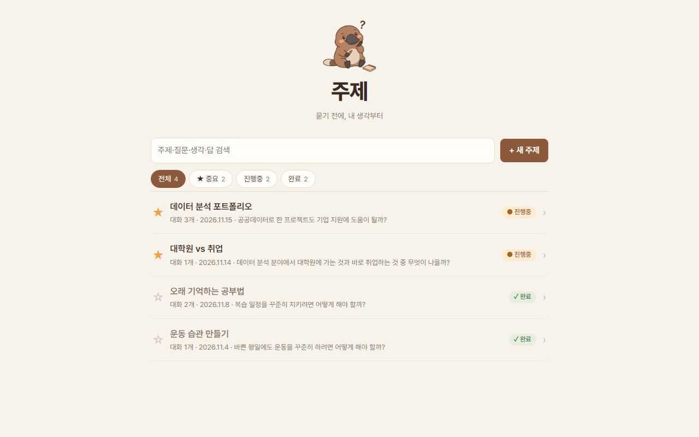
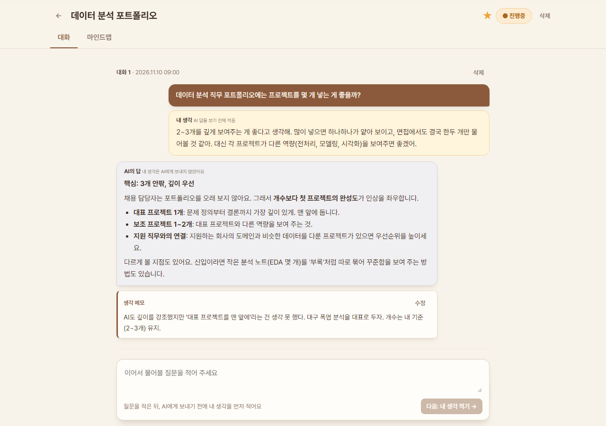
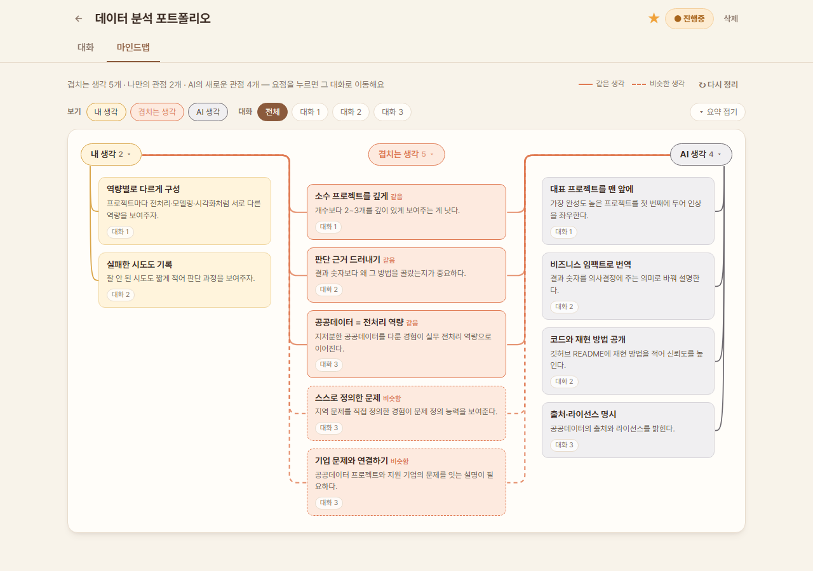
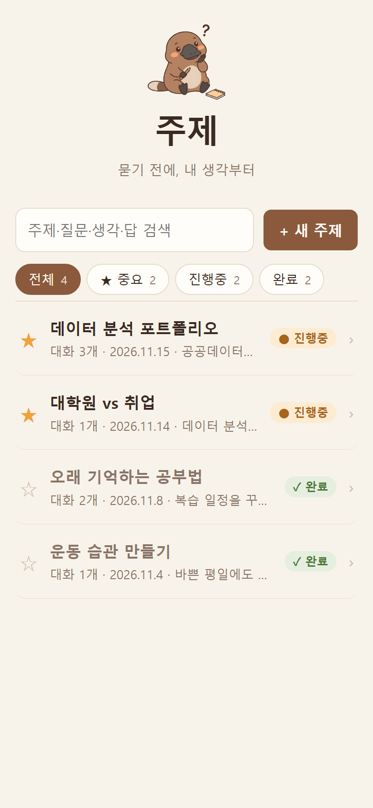

# 생각 먼저 (Think First)

> AI에게 묻기 전에, **내 생각부터** 적는 질문 노트

AI의 답을 보려면 먼저 내 생각을 적어야 하고, 쌓인 대화는 **내 생각과 AI 생각이 어디서 겹치고 어디서 갈리는지** 마인드맵으로 정리됩니다.



## 만든 이유

AI를 쓰고 나면, 원래 하던 생각은 잊어버리고 AI의 말을 그대로 따라가게 되는 불편함을 느꼈습니다.
AI가 답을 잘 주는 것과 별개로, **생각의 주도권**이 나에게서 AI로 넘어가는 문제였습니다.

그래서 세 가지 원칙으로 만들었습니다.

1. **순서 강제** — 질문 → 내 생각(20자 이상) → AI 답. 내 생각을 적기 전에는 AI 답을 볼 수 없습니다.
2. **편향 차단** — AI에게는 질문만 보내고 내 생각은 보내지 않습니다. AI가 내 생각에 맞장구치지 않아서, 두 생각을 독립적으로 비교할 수 있습니다.
3. **차이를 눈에 보이게** — 내 생각과 AI 생각을 나란히 두고, 겹치는 생각·나만의 관점·AI만의 관점을 마인드맵으로 나눕니다.

## 화면

### 1. 대화 — 질문 · 내 생각 · AI 답이 한 세트


- 일반 채팅처럼 대화가 이어지지만, 입력창이 `① 질문 → ② 내 생각 → AI 답 보기` 두 단계로 되어 있습니다.
- 내 생각에는 "AI 답을 보기 전에 적음" 표시가 붙고, 나중에 고칠 수 없습니다.
- 턴마다 **생각 메모**로 AI 답과 비교한 소감을 남깁니다.

### 2. 마인드맵 — 세 영역 수렴형


- **왼쪽** 나만의 관점 / **가운데** 겹치는 생각(실선: 같음, 점선: 비슷함) / **오른쪽** AI만의 관점
- 요점을 누르면 그 내용이 나온 대화 위치로 이동해 강조됩니다.
- 요약 접기, 영역별 접기, 대화별 골라 보기를 지원하고, 보기 설정은 주제마다 기억됩니다.

### 3. 주제 목록
- ★ 중요 표시(위로 정렬), 진행중/완료 상태(배지를 누르면 전환, 완료된 주제에서 대화를 이어 가면 자동으로 진행중), 필터, 전체 검색



모바일 화면도 지원합니다.

## 설계 결정

| 결정 | 이유 |
|---|---|
| AI 답변 요청에 내 생각을 넣지 않음 | 내 생각을 보면 AI가 동의하는 방향으로 답하기 쉬워 비교가 무의미해짐. 두 번째 질문부터는 이전 질문과 **AI 답**만 대화 기록으로 보냄 |
| 내 생각은 수정 불가, 생각 메모는 수정 가능 | "AI 답을 보기 전의 생각"이라는 기록 자체가 의미. 바뀐 생각은 메모에 남김 |
| 마인드맵은 구조화 출력(JSON 스키마)으로 생성 | 요점마다 근거 대화 ID(`turn_ids`)를 받아 대화 위치로 점프할 수 있게 함. 존재하지 않는 ID는 서버에서 걸러 냄 |
| 마인드맵 결과를 저장하고 대화가 바뀔 때만 다시 생성 | 탭을 열 때마다 API를 부르지 않도록 대화 ID 목록을 서명처럼 비교 |
| 프레임워크 없이 HTML/CSS/JS | 화면이 단순하고 빌드 과정 없이 바로 실행되도록 |
| DB 구조 변경 시 자동 이전 | 질문 1개 단위 → 주제·대화 구조로 바꿀 때 기존 기록을 잃지 않도록, 원래 표는 `entries_legacy`로 보존 |

코드가 어떻게 동작하는지는 [docs/HOW_IT_WORKS.md](docs/HOW_IT_WORKS.md)에 정리했습니다.

## 개발 과정

| 단계 | 바꾼 점 | 왜 |
|---|---|---|
| v1 | 질문 1개 = 기록 1개. 내 생각과 AI 답을 좌우로 비교, 돌아보기 작성 | 핵심 아이디어("생각 먼저") 검증 |
| v1.1 | 진행중/완료 상태, 질문별 마인드맵(양쪽 요점을 선으로 연결) | 기록이 쌓이며 정리·비교 필요 |
| v2 | **주제 1 : 대화 N 구조로 전면 개편**, 대화 탭/마인드맵 탭 분리, 겹치는 생각을 **가운데로 모으는 수렴형** 마인드맵, 턴별 생각 메모 | 실제 고민은 질문 하나로 끝나지 않고 이어짐. 양쪽 연결선은 많아지면 읽기 어려워 겹치는 내용을 한곳에 모음 |
| v2.1 | 마스코트·색·글꼴 등 디자인 정리, 상태 배지 하나로 전환, 마인드맵 접기·골라 보기 | 사용하면서 불편했던 점 개선 |

## 기술

- **백엔드**: Python, Flask, SQLite
- **AI**: Anthropic Claude API — 답변은 스트리밍, 마인드맵은 구조화 출력(JSON 스키마)
- **프론트엔드**: HTML/CSS/JavaScript(프레임워크 없음), 해시 라우팅, SVG 연결선, 반응형

## 만든 방식 (AI 활용)

- **직접 한 것**: 문제 정의, 기능·화면 기획과 우선순위, 사용 흐름 설계, 디자인 방향(마스코트·색), 결과 확인과 수정 요청
- **AI와 함께 한 것**: 코드 구현은 Claude Code(AI 코딩 도구)와 협업했습니다. 제가 요구사항과 수정 방향을 정하고, AI가 코드를 작성하고, 저는 결과를 확인하고 다음 수정을 요청하는 방식으로 진행했습니다.

## 출처

- 마스코트(오리너구리): 생성형 AI 이미지 도구로 만든 그림을 배경만 지워 사용
- 글꼴: [Pretendard](https://github.com/orioncactus/pretendard) (SIL OFL 1.1)
- 그림자·둥글기·움직임 값: [Open Props](https://github.com/argyleink/open-props) (MIT)

## 한계와 다음 계획

- [ ] 실제 Claude API로 답변·마인드맵 생성 품질과 응답 시간, 비용 검증
- [ ] 2주 이상 직접 사용하고 결과 정리 (겹치는 비율, 나만의 관점 비율 변화)
- [ ] 사용 통계 화면
- [ ] 마인드맵 요점 직접 수정·합치기
- [ ] 테스트 코드
- [ ] 공개 배포용 데모 모드(로그인·사용량 제한 없이는 API 키를 쓰는 배포 금지)
- 현재는 혼자 쓰는 로컬 앱입니다. 로그인, 요청 횟수 제한이 없습니다.
- 20자 제한은 형식만 확인하며, 생각의 질은 확인하지 않습니다.

## 실행 방법

```bash
pip install -r requirements.txt
cp .env.example .env      # ANTHROPIC_API_KEY 입력 (.env는 git에 올라가지 않음)
python app.py             # http://localhost:5050
```

| 하고 싶은 것 | 명령 |
|---|---|
| API 키 없이 화면만 보기 (가짜 AI 답) | `python app.py --demo` |
| 예시 주제 4개 넣기 | `python seed_demo.py` |
| 다른 DB·포트로 실행 | `python app.py --db=data/other.db --port=5051` |
| 디버그 모드 | `FLASK_DEBUG=1 python app.py` |
